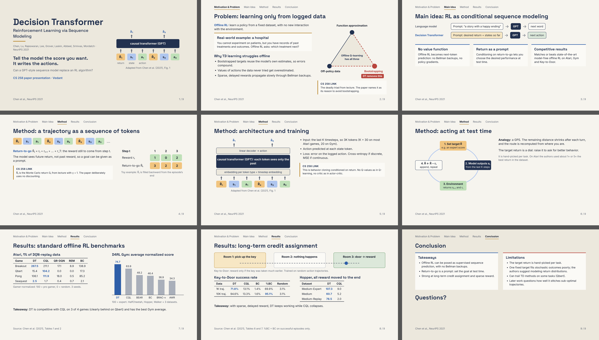

# cs258-pres

CS 258 / EE 227 (Reinforcement Learning, UCR) paper presentation:
**Decision Transformer: Reinforcement Learning via Sequence Modeling** (Chen et al., NeurIPS 2021).

9 slides, about 8 minutes, following the course structure:
Motivation & Problem → Main Idea → Method → Results → Conclusion.

## Contents

- `deck/` — the slide source (one HTML section per slide, shared `deck.css`, `deck.json` index). Speaker notes with timings are in each slide's `<aside>`.
- `screenshots/` — rendered previews.

## Timing

| # | Slide | Time |
|---|---|---|
| 1 | Cover / pitch | 0:30 |
| 2 | Motivation & problem (hospital example, deadly triad) | 1:00 |
| 3 | Main idea & contributions | 1:00 |
| 4 | Tokens & return-to-go (Gₜ with γ = 1) | 0:50 |
| 5 | Architecture & training (return-conditioned BC) | 1:00 |
| 6 | Test-time loop | 0:50 |
| 7 | Benchmark results | 1:10 |
| 8 | Credit assignment results | 0:50 |
| 9 | Conclusion & limitations | 0:50 |
|   | **Total** | **8:00** |

All numbers are from Chen et al. (2021), Tables 1, 2, 6 and 7. The hospital scenario is illustrative; the paper does not evaluate it.
